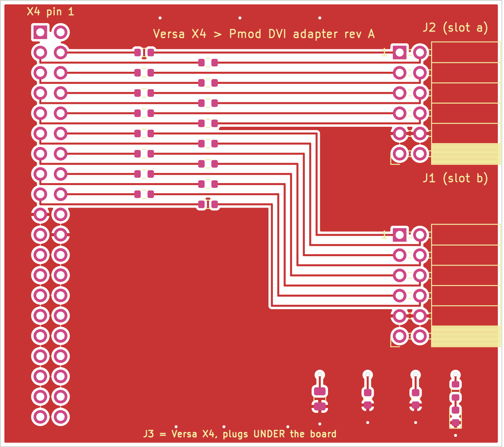

# ecp5-versa-pmod

Three Pmod host ports for the Lattice **ECP5 Versa** development board, plugged onto its expansion header **X4**.
A generic adapter, built so that the 1BitSquared **12-bit DVI Pmod** (a dual-wide module) fits exactly on two adjacent ports.
Rev A, designed 2026-11-12, built and tested (see [Commissioning](#commissioning)). Open source hardware.



| Item | Value |
|---|---|
| Board | 67.0 x 42.5 mm, 2 layers, 1.6 mm FR-4, rounded corners, no mounting holes (it hangs on the 2x20 socket) |
| J1 | 2x20 female socket 2.54 mm on the **bottom**, onto X4; stand-off = socket height (8.5 mm) above the X4 header body |
| J2, J3, J4 | Pmod ports A, B, C: 2x6 female right-angle sockets on the edge that lies over the Versa board edge, 22.86 mm (0.90 in) apart, near pin row 10.16 mm (0.40 in) from the edge, exactly as in the Pmod Interface Specification 1.3.1 figure 5 |
| Signals | X4 IO0..7 on port A, IO8..15 on port B, IO16..23 on port C, 33 ohm series resistor in every line (R1..R24, 0603) |
| Power | 3V3 from X4 pin 20 through F1 (0.5 A PTC) to all ports; 10 uF + 3 x 100 nF; green LED |
| Unused | X4 IO24..28, RESOUT#, CARDSEL# (not connected) |

## Files

| Path | Content |
|---|---|
| `ecp5-versa-pmod.kicad_pro`, `.kicad_sch`, `.kicad_pcb` | the design (KiCad 10); `lib/` holds the project symbol and footprint libraries, `fp-lib-table` / `sym-lib-table` point to them |
| `tools/generate.py` | wrote rev A from the pin tables in it (schematic, board, libraries); kept for reproducibility, from now on edit the KiCad files |
| `tools/check.py` | compares the board nets with the schematic netlist independently of KiCad, checks the DVI Pmod fit, writes `out/pinmap.csv` |
| `tools/release.sh` | ERC, DRC with schematic parity, the check above, schematic PDF, BOM, Gerbers + drill + placement, 1:1 fit-check PDF, STEP, renders |
| `out/` | everything `release.sh` produces: `ecp5-versa-pmod-gerber.zip`, `bom.csv`, `ecp5-versa-pmod-pos.csv`, `ecp5-versa-pmod-schematic.pdf`, `ecp5-versa-pmod-fitcheck-top-1to1.pdf`, `pinmap.csv`, `erc.rpt`, `drc.rpt`, STEP |
| `preview/` | `top.png`, `bottom.png`, `iso.png` |
| `docs/notes.md` | the facts about the Versa, the Pmod specification and the DVI Pmod that the design rests on, with sources |

The schematic is one A3 sheet drawn with wires: X4 on the left with IO0..IO23 on its right side in order (grouped per
port) and 3V3, GND and the unused pins on its left; the 24 series resistors in two staggered columns; the three ports
on the right with their signal pins in connector column order (1, 7, 2, 8, ...), so every X4 pin pair ends on two
adjacent port pins and no wire crosses another; the power section (F1, rails, C1..C4, LED) below X4.

State of rev A: ERC 0, DRC 0 (all severities, schematic parity included), 0 unconnected, netlist cross-check 0 mismatches.

```sh
sh tools/release.sh          # verify and regenerate all outputs (kicad-cli 10)
python3 tools/generate.py    # regenerate the KiCad files from the tables (python3 with KiCad 10 pcbnew)
```

## How it sits on the Versa

X4 runs along the Versa's top edge (the edge opposite the PCIe fingers), about 1 mm from it, with X3 25 mm further in.
X4 pin 1 is at the left end in the row nearer X3 (triangle on the Versa silkscreen), so the even pins face the board edge.
The adapter plugs on with its component side up, `X4 pin 1` marked bottom left; its port edge then lies over the Versa's
board edge and the modules hang outside the Versa, coplanar, about 11 mm above the Versa's surface. The adapter extends
2.8 mm beyond X4 toward X3 (X3 is 25 mm away) and 14 mm beyond the right end of X4, which is beyond the Versa's right edge.
Nothing of the Versa is in the way of a module on any port.

Reverse insertion (adapter rotated 180 degrees on X4) is harmless: the adapter's 3V3 lands on IO16, its GND pins on GND
pins, and its signal lines on IO17..27, CARDSEL# and GND pins through the series resistors. The ports just stay dead.

## Pin map (generated, `out/pinmap.csv`)

Pins 5 and 11 of every port are GND, pins 6 and 12 are 3V3. Pins 1..6 are the upper row (farther from the Versa edge),
7..12 the lower row; pin 1 is at the left end of the upper row when the Versa edge is at the top.

| Port | Pmod pin | X4 pin | X4 signal | FPGA ball | ECP5 pad | Pair | DVI Pmod (A+B) |
|---|---|---|---|---|---|---|---|
| A | 1 | 3 | IO0 | A12 | PT49A | with pin 7 (PT49) | R3 |
| A | 2 | 5 | IO2 | B13 | PT51A | with pin 8 (PT51) | R1 |
| A | 3 | 7 | IO4 | D13 | PT53A | with pin 9 (PT53) | G3 |
| A | 4 | 9 | IO6 | A14 | PT56A | with pin 10 (PT56) | G1 |
| A | 7 | 4 | IO1 | A13 | PT49B | with pin 1 (PT49) | R2 |
| A | 8 | 6 | IO3 | C13 | PT51B | with pin 2 (PT51) | R0 |
| A | 9 | 8 | IO5 | E13 | PT53B | with pin 3 (PT53) | G2 |
| A | 10 | 10 | IO7 | C14 | PT56B | with pin 4 (PT56) | G0 |
| B | 1 | 11 | IO8 | D14 | PT58A | with pin 7 (PT58) | B3 |
| B | 2 | 13 | IO10 | D11 | PT42A/PCLKT1_1 | no pair | CLK |
| B | 3 | 15 | IO12 | A9 | PT33A/GR_PCLK0_1 | with pin 9 (PT33) | B0 |
| B | 4 | 17 | IO14 | D12 | PT47A/GR_PCLK1_0 | with pin 10 (PT47) | HS |
| B | 7 | 12 | IO9 | E14 | PT58B | with pin 1 (PT58) | B2 |
| B | 8 | 14 | IO11 | C10 | PT31B | no pair | B1 |
| B | 9 | 16 | IO13 | B10 | PT33B/GR_PCLK0_0 | with pin 3 (PT33) | DE |
| B | 10 | 18 | IO15 | E12 | PT47B/GR_PCLK1_1 | with pin 4 (PT47) | VS |
| C | 1 | 21 | IO16 | B15 | PT69A | with pin 7 (PT69) |  |
| C | 2 | 25 | IO18 | D15 | PT71A | with pin 8 (PT71) |  |
| C | 3 | 28 | IO20 | A16 | PT74A | with pin 9 (PT74) |  |
| C | 4 | 31 | IO22 | C16 | PT76A | with pin 10 (PT76) |  |
| C | 7 | 23 | IO17 | C15 | PT69B | with pin 1 (PT69) |  |
| C | 8 | 27 | IO19 | E15 | PT71B | with pin 2 (PT71) |  |
| C | 9 | 29 | IO21 | B16 | PT74B | with pin 3 (PT74) |  |
| C | 10 | 32 | IO23 | D16 | PT76B | with pin 4 (PT76) |  |

Each port column (n, n+6) is one ECP5 differential pair with the true half (PIOA) on pin n, except port B column 2
(IO10/IO11). IO10 on port B pin 2 is `PCLKT1_1`, a primary clock input: use port B pin 2 for a Pmod that supplies a clock.
IO12..15 are general-routing clock inputs. All X4 IOs are 3.3 V LVCMOS (banks 0 and 1 of the LFE5UM-45F).

Any gateware pin assignment is allowed; `docs/notes.md` has the balls as a LiteX/Amaranth style connector table.

## Design notes

- **Why column pairs.** The X4 pin pairs (3,4), (5,6) ... are ECP5 A/B pairs, so wiring one X4 pair to one Pmod column
  gives differential-capable columns with every line on the top layer and no vias. Digilent's digital high-speed ports pair
  pins 1-2 instead; that would need a second routing layer under the signals and was not worth it.
- **33 ohm series resistors** (not Digilent's 200 ohm): source termination that works for the 25 MHz DVI pixel bus and for
  faster modules (HyperRAM), while still limiting the current of an accidental driver conflict. 0 ohm or 200 ohm fit the
  same footprint.
- **F1, 0.5 A PTC.** X4 has a single 3V3 pin. Three modules at the specification's ~100 mA stay below the hold current; a
  shorted module trips F1 instead of dragging the Versa's rail. About 50 mV drop at 100 mA.
- **3V3 feed.** X4 pin 20 sits in the inner row, so the feed has to pass between two socket pads (0.84 mm gap). It
  leaves on both layers at 0.4 mm, the widest the gap allows, and both copies run along the bottom edge (where no
  signal return current flows) and straight up into F1, 2 x 0.5 mm: no point narrower than the trunk.
- **Ground.** Pours on both layers; the X4 socket's eight GND pins are tied together by a 0.4 mm track on the bottom
  (no pour fits between 2.54 mm pins), the port GND pins have thermal reliefs.
- **Series resistors at the FPGA end** (right above X4), doglegs at 60 degrees so the three bundles never cross.
- **Silkscreen.** Top: port names, pin 1/7 marks, the X4 IO numbers of every signal column, GND/3V3, the X4 pin 1 corner,
  the F1 and LED labels. Bottom: the full pin table with FPGA balls, the X4 pin 1 corner. OSHW logo on both sides.
  All labels are generated from the same table as the netlist.

## 12-bit DVI Pmod (1BitSquared, hardware v1.1a)

Module J2 (LiteX slot "a": R3 R1 G3 G1 / R2 R0 G2 G0) goes on **port A**, module J1 (slot "b": B3 CLK B0 HS / B2 B1 DE VS)
on **port B**; ports B+C work the same way. The module's connectors are 22.89 mm apart, the adapter's 22.86 mm (0.03 mm,
nothing at 2.54 mm pitch); `tools/check.py` recomputes this from the module's PCB coordinates. The module then hangs
40 mm beyond the Versa edge, its HDMI jack away from the Versa. The last column of the table above gives the module
signal on every adapter pin.

## Parts (`out/bom.csv`; LCSC numbers also in the schematic fields)

LCSC is the JLCPCB assembly source. The Reichelt and Conrad columns are the parts actually ordered for hand assembly
(prices as ordered, 2026-11). The Reichelt parts are substitutes with the same value and package, not the same manufacturer parts.

| Ref | Part | LCSC | Reichelt (qty, price) | Conrad |
|---|---|---|---|---|
| R1..R24 | 33 ohm 1% 0603 | C23140 (UNI-ROYAL 0603WAF330JT5E) | VIS CRCW060333R, 100 mW (50, 0,04 EUR) | |
| R25 | 1 kohm 1% 0603 | C21190 (UNI-ROYAL 0603WAF1001T5E) | WAL WR06X1001FTL, 100 mW (5, 0,02 EUR) | |
| C1 | 10 uF 0805 | C15850 (Samsung CL21A106KAYNNNE, X5R 25 V) | CL21B106KOQNNNE, X7R 16 V, 10 %, 1,25 mm high (5, 0,27 EUR) | |
| C2..C4 | 100 nF 0603 | C14663 (YAGEO CC0603KRX7R9BB104, X7R 50 V) | X7R-G0603 100N, X7R 16 V, 10 % (10, 0,03 EUR) | |
| D1 | green LED 0603 | C72043 (Everlight 19-217/GHC-YR1S2/3T, **Extended**) | LED EL 0603 GR1, 112 mcd, 120 deg (5, 0,07 EUR) | |
| F1 | PTC resettable fuse 1206, Ihold 0.5 A | **not chosen** in the JLCPCB library; C70069 turned out to be a 250 mA part | SMD1206P050TF, 0.5 A, **6 V** (5, 0,14 EUR) | |
| J1 | 2x20 female 2.54 mm, straight | C2977589 (ZHOURI 2.54-2*20, 8.5 mm insulator, 3.2 mm tails) | MPE 094-2-040 (2, 1,10 EUR) | |
| J2..J4 | 2x6 female right angle 2.54 mm | C2897426 (HCTL PM254-2-06-W-8.5) | | econ connect BLW2X6 (Conrad shows 1 St. per item) |

Checked 2026-11-12 for the LCSC parts: R1..R24, C1 and D1 part pages read (Basic/Extended not shown, except D1 is Extended);
R25 and C2..C4 Basic (earlier session); J1 page read, straight socket inferred from "holes direction: top"; J2..J4 page
read (2 rows, 12 pins, right angle, 3 A), the **drawing was not readable**. Any 0603 LED fits D1, the 1 k gives about 0.6 mA.

The Reichelt and Conrad parts above were used for the built and tested rev A board and fit. The JLCPCB-side LCSC parts
were not ordered. The F1 part is rated 6 V, which is enough on the 3.3 V rail but not for a 5 V source; the earlier note
asked for 16 V or more.

LCSC stock and prices were not visible to the tools used. The sockets are through-hole (JLCPCB assembles them only as a
special service, or solder them by hand). Choose the 2x20 socket height to taste; 8.5 mm puts the module 11 mm above
the Versa.

## Commissioning

Rev A was assembled by hand with the Reichelt and Conrad parts listed above and tested on an ECP5 Versa by the author
(2026-11-22): it works. The individual test steps were not recorded. The silkscreen copyright text on the front
(`(c) 2026 Dirk Eibach`, 90 degrees at the left edge) was added to the PCB after the rev A Gerbers in `out/` were generated, so
the board that was built does not have it; rerun `tools/release.sh` before the next order.

### Checks before ordering (rev A)

1. Print `out/ecp5-versa-pmod-fitcheck-top-1to1.pdf` at 100 % and lay the DVI Pmod's connectors on it (J2 on A, J1 on B).
2. Compare the right-angle socket's drawing (HCTL and the Conrad BLW2X6) with the footprint (pin rows 2.54 mm apart, near
   row 10.16 mm from the edge, body front flush with the edge), and the MPE 094-2-040 height with the 8.5 mm assumed.
3. Load `out/ecp5-versa-pmod-gerber.zip` in a Gerber viewer once (it was checked by DRC and by the renders only).
4. Check that the Versa's X4 pin 1 is where `docs/notes.md` says (lower left, square pad with a triangle); if it were in the
   outer row the adapter would have to be mirrored (`tools/generate.py` keeps this in two constants).
